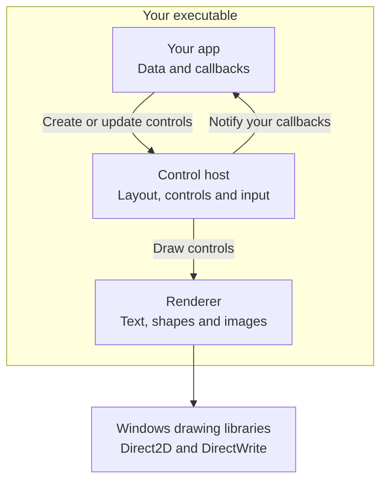
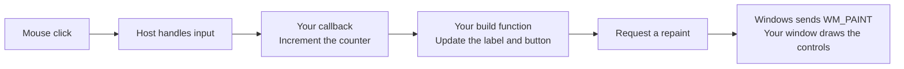
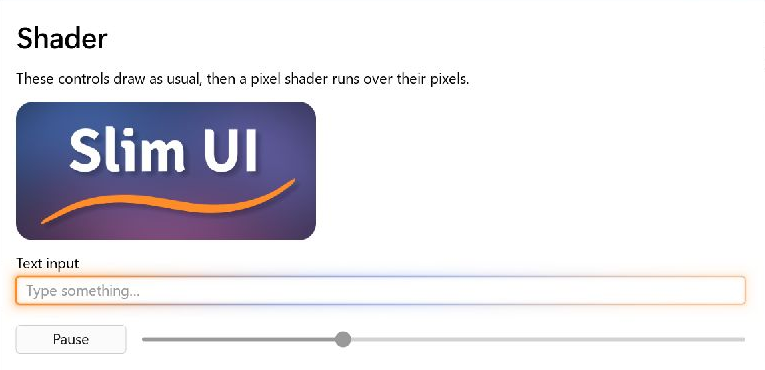

<p align="center">
  
</p>

<p align="center">
  <strong>Small Windows apps. Sharp text. Smooth controls.</strong><br>
  A header-only UI toolkit in C, built on Direct2D and DirectWrite.
</p>

<p align="center">
  <a href="#try-the-demo">Try the demo</a> ·
  <a href="#your-first-window">Build a window</a> ·
  <a href="docs/reference.md">API reference</a> ·
  <a href="dotnet/README.md">C# / .NET</a>
</p>

<picture>
  <source media="(prefers-color-scheme: dark)" srcset="docs/demo-dark.png">
  
</picture>

<p align="center"><sub>The Slim UI demo. Light and dark themes are built in.</sub></p>

## Why Slim UI?

- **Very small apps.** A label-and-button app can be about 61 KB. Leave out unused controls and, for the smallest builds, the C runtime.
- **One file to ship.** C and C++ apps can ship as a single `.exe`. Link the C runtime statically; the remaining libraries come with Windows.
- **Customize anything.** Set colors and fonts globally or per control. Controls live in separate C headers—the slider is about 120 lines—so you can modify them or build your own, with or without an LLM.
- **Lists that fetch data as needed.** Virtualized lists and drop-downs request items from your data through callbacks, without copying the entire collection into controls.
- **Layout your way.** Use automatic rows, columns and wrapping flows, flexible sizing and scrolling containers—or place controls at exact pixel positions. Automatic layouts scale with DPI.
- **Smooth animation.** Enable vsync for hover fades, tab transitions and drop-down animations paced to your display. Windows and popups share a clock that sleeps when no animation needs it.
- **GPU effects.** Add your own drawing or animated pixel shaders to any control. Its input, focus and click handling stay intact.
- **Sharp on every display.** DirectWrite fits text to the pixel grid. Automatic layout scales with DPI, and helpers handle monitor-scale changes.
- **Easy to add.** Use a folder of headers from C or C++, with no toolkit binary to install. The [C# / .NET wrapper](dotnet/README.md) handles window setup and events for you.
- **Keyboard and screen reader support.** Tab navigation, focus rings and Windows UI Automation are built in, alongside light and dark themes. Supported accessibility actions vary by control; see the [accessibility reference](docs/reference.md#accessibility-uia).

## Why not Win32 controls or WinUI?

The stock [Win32 controls](https://learn.microsoft.com/en-us/windows/win32/controls/window-controls) look dated, and modernizing their appearance takes work. [WinUI 3](https://learn.microsoft.com/en-us/windows/apps/winui/winui3/) supplies modern Fluent controls with extensive [style and template customization](https://learn.microsoft.com/en-us/windows/apps/develop/platform/xaml/xaml-control-templates), but adds a Windows App SDK runtime dependency that must be [deployed separately or bundled with your app](https://learn.microsoft.com/en-us/windows/apps/package-and-deploy/deploy-overview).

**Slim UI makes a control's actual behavior easy to change.** Its implementations live in C headers you compile into your app. For example, the [slider header](include/slim_ui/sui_ctrl_slider.h) contains its drawing, mouse-to-value calculation and keyboard handling. To change how it snaps or how far an arrow key moves it, edit that code and rebuild your app. You can follow the implementation directly and change the rule you care about.

Light and dark themes, animation and layouts written in code come with it. Drawing uses Direct2D and DirectWrite already provided by Windows, so C/C++ apps need no separate toolkit runtime.

## Try the demo

On Windows 10 version 1703 or later, with Visual Studio 2022's C++ tools and CMake installed:

```powershell
git clone https://github.com/live-sound/slim-ui.git
cd slim-ui\demo
.\build.ps1
.\build\Release\sui_demo.exe
```

Explore the controls, switch themes and fonts, and try the animated Shader page.

## How it fits together

For a C or C++ app, Slim UI compiles into your executable. Your app owns its data; the host keeps the controls, focus and input state. The renderer draws through libraries already on Windows.



**The control logic is yours to change.** Edit a slider's keyboard handling in its [control header](include/slim_ui/sui_ctrl_slider.h), or change shared focus navigation in the [host](include/slim_ui/sui_controls.h). The diagram's boxes are ordinary C code you can follow and modify.

<details>
<summary>Follow a click through the example below</summary>



This example rebuilds its controls when the count changes. Rebuilding is an app decision; ordinary input handling does not require rebuilding the whole window. Keep values you want to preserve in your app's data.

</details>

## Your first window

Describe your layout in C. Slim UI places the controls and scales them for the display:

```c
sui_begin(host, sui_inset(16.0f), 8.0f, SUI_CLEAR_PAGE);
    sui_label(host, app->message);
    sui_button(host, ID_BUTTON, L"Click me", SUI_BTN_DEFAULT);
sui_end(host);
```

Keep your app's data in your own struct and rebuild the layout when it changes. You can also [place controls at exact pixel positions](docs/reference.md#controls--imperative-api).

<details>
<summary><strong>Complete example: a window that counts your clicks</strong></summary>

This program includes the window setup, drawing and input handling. It uses automatic layout and vsync animation.

```c
#define SUI_FEATURE_CUSTOM_CONTROLS
#define SUI_FEATURE_DECL
#define SUI_FEATURE_VSYNC
#define SUI_IMPLEMENTATION
#include <slim_ui/slim_ui.h>

enum { ID_BUTTON = 1 };

typedef struct App {
    SuiRenderer    renderer;
    SuiControlHost host;
    wchar_t        message[64];
    int            clicks;
} App;

/* Describes the whole window. Call it again whenever something changes. */
static void build(App* app) {
    SuiControlHost* host = &app->host;
    sui_begin(host, sui_inset(16.0f), 8.0f, SUI_CLEAR_PAGE);
    sui_label(host, app->message);
    sui_button(host, ID_BUTTON, L"Click me", SUI_BTN_DEFAULT);
    sui_end(host);
}

static void on_click(int id, void* data) {
    App* app = data;
    if (id == ID_BUTTON) {
        wsprintfW(app->message, L"Clicks: %d", ++app->clicks);
        build(app);
        InvalidateRect(app->host.hwnd, NULL, FALSE);
    }
}

static LRESULT CALLBACK window_proc(HWND hwnd, UINT msg, WPARAM wp, LPARAM lp) {
    App* app = (App*)GetWindowLongPtrW(hwnd, GWLP_USERDATA);
    LRESULT result = 0;

    /* Mouse, keyboard, focus, timers and screen readers are handled here. */
    if (app && sui_default_msg(&app->host, hwnd, msg, wp, lp, &result)) return result;

    switch (msg) {
    case WM_CREATE:
        app = ((CREATESTRUCTW*)lp)->lpCreateParams;
        SetWindowLongPtrW(hwnd, GWLP_USERDATA, (LONG_PTR)app);
        sui_renderer_init_fields(&app->renderer);
        sui_renderer_init(&app->renderer, hwnd);
        sui_ctrl_host_init(&app->host, hwnd, &app->renderer, &sui_scheme_light, GetDpiForWindow(hwnd));
        app->host.on_click = on_click;
        app->host.on_click_data = app;
        return 0;
    case WM_SIZE:
        sui_renderer_resize(&app->renderer, LOWORD(lp), HIWORD(lp));
        build(app);
        return 0;
    case WM_PAINT: {
        PAINTSTRUCT ps;
        BeginPaint(hwnd, &ps);
        sui_renderer_begin(&app->renderer);
        sui_renderer_clear(&app->renderer, app->host.scheme->background);
        sui_ctrl_draw_all(&app->host);
        sui_renderer_end(&app->renderer);
        EndPaint(hwnd, &ps);
        return 0;
    }
    case WM_SUI_VSYNC:
        sui_ctrl_on_vsync(&app->host);
        InvalidateRect(hwnd, NULL, FALSE);
        return 0;
    case WM_DESTROY:
        sui_ctrl_host_release(&app->host);
        sui_renderer_release(&app->renderer);
        PostQuitMessage(0);
        return 0;
    }
    return DefWindowProcW(hwnd, msg, wp, lp);
}

int WINAPI wWinMain(HINSTANCE instance, HINSTANCE prev, PWSTR args, int show) {
    static App app = { .message = L"Hello from Slim UI" };
    WNDCLASSW window_class = { .lpfnWndProc = window_proc, .hInstance = instance, .lpszClassName = L"Hello" };
    MSG msg;

    SetProcessDpiAwarenessContext(DPI_AWARENESS_CONTEXT_PER_MONITOR_AWARE_V2);
    RegisterClassW(&window_class);
    ShowWindow(CreateWindowExW(0, L"Hello", L"Hello", WS_OVERLAPPEDWINDOW, CW_USEDEFAULT, CW_USEDEFAULT,
                               420, 240, NULL, NULL, instance, &app), show);
    while (GetMessageW(&msg, NULL, 0, 0)) {
        TranslateMessage(&msg);
        DispatchMessageW(&msg);
    }
    return 0;
}
```

Save it as `hello.c`, put Slim UI in a `slim-ui` folder next to it, and add this `CMakeLists.txt`:

```cmake
cmake_minimum_required(VERSION 3.21)
project(hello C)

# Puts the C runtime inside hello.exe, so there are no extra DLLs to ship.
set(CMAKE_MSVC_RUNTIME_LIBRARY "MultiThreaded$<$<CONFIG:Debug>:Debug>")

add_subdirectory(slim-ui)

add_executable(hello WIN32 hello.c)
target_link_libraries(hello PRIVATE slim_ui)
```

Then build and run it:

```powershell
cmake -B build
cmake --build build --config MinSizeRel
.\build\MinSizeRel\hello.exe
```

If you'd rather skip CMake, run this from a Visual Studio developer prompt instead:

```bat
cl /O1 /utf-8 /std:c11 /I slim-ui\include hello.c d2d1.lib dwrite.lib dwmapi.lib user32.lib gdi32.lib ole32.lib shell32.lib windowscodecs.lib
```

For an app that moves between monitors, also handle `WM_DPICHANGED`. The [full window procedure](docs/reference.md#full-wndproc-wiring) shows how.

</details>

For the smallest build, see [`examples/tiny.c`](examples/tiny.c) and run `examples\build-tiny.cmd` from a Visual Studio developer prompt. It removes unused controls and the C runtime; app size depends on your controls and build settings. For C# setup and examples, see the [.NET guide](dotnet/README.md).

## What's included

| Kind | Controls |
|---|---|
| Actions | Buttons |
| Choices | Checkboxes, radio buttons, drop-down lists, sliders, number spinners, color swatches |
| Text | Labels, single-line inputs and editable multi-line text, with selection, clipboard, undo and redo |
| Lists and navigation | Grouped lists, animated tabs, side menus |
| Layout | Containers, scrolling areas |
| Extras | Images, progress bars, tooltips, keyboard, mouse-button and gamepad shortcut recorders |

Arrange controls in rows, columns or wrapping flows, with flexible sizing and scrolling containers. Use exact pixel positions when you need them. Lists and drop-downs can fetch items on demand from your own data. The [API reference](docs/reference.md) covers setup, controls and customization.

## Give your controls a different look

A custom paint callback lets you change how a control draws. The demo uses it to put an animated dusk background behind the logo and a flowing glow around a text field. Typing, focus and clicks still work as usual.

<picture>
  <source media="(prefers-color-scheme: dark)" srcset="docs/shader-dark.png">
  
</picture>

The demo includes a [night sky shader](demo/shader_dusk.hlsl) and a [glow shader](demo/shader_glow.hlsl). Start with `PaintWithShader` in [`demo/main.cpp`](demo/main.cpp) and its [Direct2D effect](demo/shader_effect.cpp): the shader integration is example code you can adapt.

## Explore and contribute

- [API reference](docs/reference.md) — controls, layout, themes and lifecycle.
- [Demo source](demo/main.cpp) — a working app that exercises every control.
- [C# / .NET guide](dotnet/README.md) — build the same UI without writing Win32 code.

Found a bug or have an idea? [Open an issue](https://github.com/live-sound/slim-ui/issues) with a small example or a description of what you'd like to build. Pull requests are welcome.

## License

Free to use and modify under the [MIT License](LICENSE).
