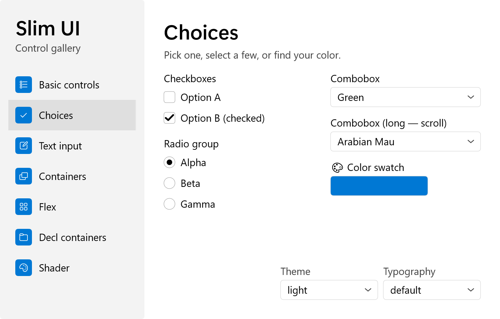
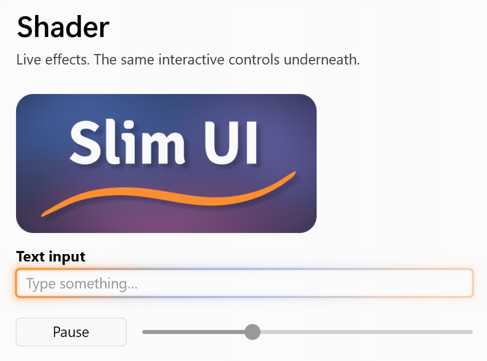
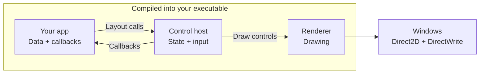
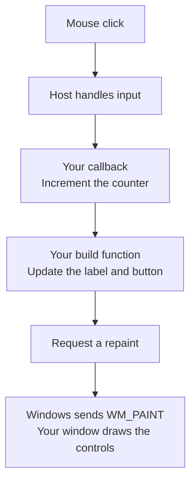

<p align="center">
  
</p>

<p align="center">
  <strong>Build small Windows apps. Make the controls your own.</strong><br>
  A header-only UI toolkit in C for Windows 7 and later, built on Direct2D and DirectWrite.
</p>

<p align="center">
  <a href="#try-the-demo">Try the demo</a> ·
  <a href="#your-first-window">Build a window</a> ·
  <a href="docs/reference.md">API reference</a> ·
  <a href="dotnet/README.md">C# / .NET</a>
</p>

<p align="center">Used by <a href="https://github.com/live-sound/small-installer">Small Installer</a>.</p>

## Why Slim UI?

- **Very small apps.** The [label-and-button example](examples/tiny.c) builds to about 61 KB with unused controls and the C runtime removed.
- **One file to ship.** C and C++ apps can ship as a single `.exe`. Link the C runtime statically; the remaining libraries come with Windows.
- **Change how controls work.** Set colors and fonts globally or per control. Go deeper by editing the C implementation—the slider is about 120 lines. Modify it or build your own, with or without an LLM.
- **Lists that fetch data as needed.** Virtualized lists and drop-downs request items through callbacks. Your data stays with your app, without copying the whole collection into controls.
- **Layout your way.** Choose rows, columns, wrapping flows, flexible sizing and scrolling containers, or exact pixel positions. Automatic layouts scale with DPI.
- **Smooth animation.** Enable vsync for hover fades, tab transitions and drop-down animations paced to your display. The shared animation clock sleeps when no animation needs it.
- **GPU effects.** Give any control custom drawing or animated pixel shaders while keeping its input, focus and click handling.
- **Sharp on every display.** DirectWrite fits text to the pixel grid. DPI-aware layout and monitor-scale helpers keep the UI sized for the display.
- **Easy to add.** Drop the headers into a C or C++ project. The [C# / .NET wrapper](dotnet/README.md) handles window setup and events for you.
- **Keyboard and screen reader support.** Tab navigation, focus rings, Windows UI Automation, and light and dark themes are built in. [Accessibility coverage](docs/reference.md#accessibility-uia) varies by control.

<picture>
  <source media="(prefers-color-scheme: dark)" srcset="docs/demo-dark.png">
  
</picture>

<p align="center"><sub>The Slim UI demo. Light and dark themes are built in.</sub></p>

## Try the demo

To build the C/C++ demo, you'll need Visual Studio 2022's C++ tools and CMake:

```powershell
git clone https://github.com/live-sound/slim-ui.git
cd slim-ui\demo
.\build.ps1
.\build\Release\sui_demo.exe
```

Switch between light and dark themes, try the text inputs and scrolling controls, then open the Shader page to see effects running on an image and a working text field.

## Your first window

This is the layout for a label and a button. Slim UI handles their positions and display scaling:

```c
sui_begin(host, sui_inset(16.0f), 8.0f, SUI_CLEAR_PAGE);
    sui_label(host, app->message);
    sui_button(host, ID_BUTTON, L"Click me", SUI_BTN_DEFAULT);
sui_end(host);
```

The complete example below counts button clicks and rebuilds this layout to show the new count. Keep values you want to preserve in your app's data. For manual placement, [give each control an exact rectangle](docs/reference.md#controls--imperative-api).

<details>
<summary><strong>Complete example: a window that counts your clicks</strong></summary>

This program includes the window setup, drawing and input handling. It uses automatic layout and vsync animation.

```c
#define SUI_FEATURE_CUSTOM_CONTROLS
#define SUI_FEATURE_DECL
#define SUI_FEATURE_VSYNC
#define SUI_IMPLEMENTATION
#include <slim_ui/slim_ui.h>

enum { ID_BUTTON = 1 };

typedef struct App {
    SuiRenderer    renderer;
    SuiControlHost host;
    wchar_t        message[64];
    int            clicks;
} App;

/* Describes the whole window. Call it again whenever something changes. */
static void build(App* app) {
    SuiControlHost* host = &app->host;
    sui_begin(host, sui_inset(16.0f), 8.0f, SUI_CLEAR_PAGE);
    sui_label(host, app->message);
    sui_button(host, ID_BUTTON, L"Click me", SUI_BTN_DEFAULT);
    sui_end(host);
}

static void on_click(int id, void* data) {
    App* app = data;
    if (id == ID_BUTTON) {
        wsprintfW(app->message, L"Clicks: %d", ++app->clicks);
        build(app);
        InvalidateRect(app->host.hwnd, NULL, FALSE);
    }
}

static LRESULT CALLBACK window_proc(HWND hwnd, UINT msg, WPARAM wp, LPARAM lp) {
    App* app = (App*)GetWindowLongPtrW(hwnd, GWLP_USERDATA);
    LRESULT result = 0;

    /* Mouse, keyboard, focus, timers and screen readers are handled here. */
    if (app && sui_default_msg(&app->host, hwnd, msg, wp, lp, &result)) return result;

    switch (msg) {
    case WM_CREATE:
        app = ((CREATESTRUCTW*)lp)->lpCreateParams;
        SetWindowLongPtrW(hwnd, GWLP_USERDATA, (LONG_PTR)app);
        sui_renderer_init_fields(&app->renderer);
        sui_renderer_init(&app->renderer, hwnd);
        sui_ctrl_host_init(&app->host, hwnd, &app->renderer, &sui_scheme_light, sui_get_window_dpi(hwnd));
        app->host.on_click = on_click;
        app->host.on_click_data = app;
        return 0;
    case WM_SIZE:
        sui_renderer_resize(&app->renderer, LOWORD(lp), HIWORD(lp));
        build(app);
        return 0;
    case WM_PAINT: {
        PAINTSTRUCT ps;
        BeginPaint(hwnd, &ps);
        sui_renderer_begin(&app->renderer);
        sui_renderer_clear(&app->renderer, app->host.scheme->background);
        sui_ctrl_draw_all(&app->host);
        sui_renderer_end(&app->renderer);
        EndPaint(hwnd, &ps);
        return 0;
    }
    case WM_SUI_VSYNC:
        sui_ctrl_on_vsync(&app->host);
        InvalidateRect(hwnd, NULL, FALSE);
        return 0;
    case WM_DESTROY:
        sui_ctrl_host_release(&app->host);
        sui_renderer_release(&app->renderer);
        PostQuitMessage(0);
        return 0;
    }
    return DefWindowProcW(hwnd, msg, wp, lp);
}

int WINAPI wWinMain(HINSTANCE instance, HINSTANCE prev, PWSTR args, int show) {
    static App app = { .message = L"Hello from Slim UI" };
    WNDCLASSW window_class = { .lpfnWndProc = window_proc, .hInstance = instance, .lpszClassName = L"Hello" };
    MSG msg;

    sui_enable_dpi_awareness();
    RegisterClassW(&window_class);
    ShowWindow(CreateWindowExW(0, L"Hello", L"Hello", WS_OVERLAPPEDWINDOW, CW_USEDEFAULT, CW_USEDEFAULT,
                               420, 240, NULL, NULL, instance, &app), show);
    while (GetMessageW(&msg, NULL, 0, 0)) {
        TranslateMessage(&msg);
        DispatchMessageW(&msg);
    }
    return 0;
}
```

Save it as `hello.c`, put Slim UI in a `slim-ui` folder next to it, and add this `CMakeLists.txt`:

```cmake
cmake_minimum_required(VERSION 3.21)
project(hello C)

# Puts the C runtime inside hello.exe, so there are no extra DLLs to ship.
set(CMAKE_MSVC_RUNTIME_LIBRARY "MultiThreaded$<$<CONFIG:Debug>:Debug>")

add_subdirectory(slim-ui)

add_executable(hello WIN32 hello.c)
target_link_libraries(hello PRIVATE slim_ui)
```

Then build and run it:

```powershell
cmake -B build
cmake --build build --config MinSizeRel
.\build\MinSizeRel\hello.exe
```

If you'd rather skip CMake, run this from a Visual Studio developer prompt instead:

```bat
cl /O1 /utf-8 /std:c11 /I slim-ui\include hello.c d2d1.lib dwrite.lib dwmapi.lib user32.lib gdi32.lib ole32.lib shell32.lib windowscodecs.lib
```

For an app that moves between monitors, also handle `WM_DPICHANGED`. The [full window procedure](docs/reference.md#full-wndproc-wiring) shows how.

</details>

For the smallest build, see [`examples/tiny.c`](examples/tiny.c) and run `examples\build-tiny.cmd` from a Visual Studio developer prompt. It removes unused controls and the C runtime; app size depends on your controls and build settings. For C# setup and examples, see the [.NET guide](dotnet/README.md).

## What's included

| Kind | Controls |
|---|---|
| Actions | Buttons |
| Choices | Checkboxes, radio buttons, drop-down lists, sliders, number spinners, color swatches |
| Text | Labels, single-line inputs and editable multi-line text, with selection, clipboard, undo and redo |
| Lists and navigation | Grouped lists, animated tabs, side menus |
| Layout | Containers, scrolling areas |
| Extras | Images, progress bars, tooltips, keyboard, mouse-button and gamepad shortcut recorders |

See the [API reference](docs/reference.md) for control options, layout and customization, or the [demo source](demo/main.cpp) for working examples.

## Give your controls a different look

The same text field can keep its normal editing behavior and gain a glowing border. A custom paint callback changes how it draws. The demo pairs that effect with an animated night sky behind the logo.

<picture>
  <source media="(prefers-color-scheme: dark)" srcset="docs/shader-dark.gif">
  
</picture>

Adapt the [night sky](demo/shader_dusk.hlsl) or [glow](demo/shader_glow.hlsl) shader, starting with `PaintWithShader` in [`demo/main.cpp`](demo/main.cpp). The demo's [Direct2D effect](demo/shader_effect.cpp) supplies the shader integration.

## How it fits together

For a C or C++ app, Slim UI compiles into your executable. Your app owns its data; the host keeps the controls, focus and input state. The renderer draws through libraries already on Windows.



Input handling lives in the [control headers](include/slim_ui) and the [host](include/slim_ui/sui_controls.h), including shared focus navigation. Follow that code to change what a control does.

<details>
<summary>Follow a click through the example above</summary>



This example rebuilds its controls when the count changes. Rebuilding is an app decision; ordinary input handling does not require rebuilding the whole window. Keep values you want to preserve in your app's data.

</details>

## Why not Win32 controls or WinUI?

**Choose Slim UI when you want to change the control itself.** Slider snapping and arrow-key increments are ordinary C functions in the [slider header](include/slim_ui/sui_ctrl_slider.h), alongside its drawing code. Edit the rule you care about and rebuild your app. The modified control compiles into your executable.

The stock [Win32 controls](https://learn.microsoft.com/en-us/windows/win32/controls/window-controls) look dated, and modernizing their appearance takes work. [WinUI 3](https://learn.microsoft.com/en-us/windows/apps/winui/winui3/) supplies modern Fluent controls with extensive style and template customization, but requires a Windows App SDK runtime [deployed separately or bundled with your app](https://learn.microsoft.com/en-us/windows/apps/package-and-deploy/deploy-overview). Slim UI uses Direct2D and DirectWrite already on Windows, with no separate toolkit runtime for C/C++ apps.

## Explore and contribute

- [API reference](docs/reference.md) — controls, layout, themes and lifecycle.
- [Demo source](demo/main.cpp) — a working app that exercises every control.
- [C# / .NET guide](dotnet/README.md) — build the same UI without writing Win32 code.

[Try the demo](#try-the-demo), change a control, and see how it fits your app. Share bugs with a small example, or [open an issue](https://github.com/live-sound/slim-ui/issues) describing what you'd like to build. Pull requests are welcome.

## License

Free to use and modify under the [MIT License](LICENSE).
